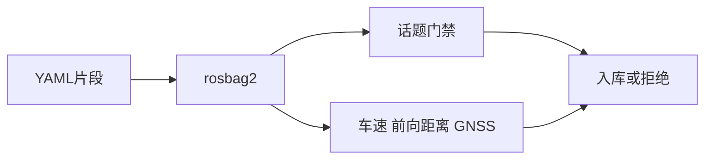

# drive-data-test

自动驾驶路采数据检查。用 YAML 描述一段行车片段，生成 rosbag2，再检查两件事：传感器话题能不能用，片段是否满足车速、前向距离和 GNSS 定位这些入库规则。样本由脚本生成，不依赖实车。

Replay checks for autonomous-driving logs. YAML describes a short drive clip. pytest checks sensor-topic health and whether speed, forward range, and GNSS fix meet the entry rules.

## 测什么

- 片段：高速巡航、前车过近、超速、GNSS 失锁、激光丢帧、IMU 时间戳回退
- 话题：`/imu/data`、`/lidar/scan`、`/gnss/fix`、`/vehicle/twist` 的频率、帧间隔、时间戳是否回退、话题是否缺失、首帧是否对齐
- 入库规则：前向最近距离不低于阈值，车速落在允许区间，GNSS 保持定位
- 正常片段必须通过；违反规则或传感器损坏的片段必须被拒绝

前向距离取激光中间两束。车速来自 `/vehicle/twist`。

## 架构



## 5 分钟跑通

```bash
python3 -m venv .venv
source .venv/bin/activate
pip install -r requirements.txt
pytest
python -m bagcheck.suite
```

只跑话题门禁：

```bash
python -m bagcheck.sample /tmp/sensors-good
python -m bagcheck /tmp/sensors-good --expect expectations/sensors.yaml

python -m bagcheck.sample /tmp/sensors-drop --drop-scan
python -m bagcheck /tmp/sensors-drop --expect expectations/sensors.yaml
```

## 片段格式

```yaml
name: 高速巡航
duration_s: 3
ego_speed_mps: 16
lead_range_m: 40
expect:
  accept: true
```

拒绝一个片段时写明失败项：

```yaml
name: 前车过近
lead_range_m: 6
expect:
  accept: false
  codes:
    - [gap_range, /lidar/scan]
```

阈值在 `expectations/drive.yaml`：前向距离 15 m，车速 0–33.3 m/s，GNSS 需要保持定位。

## 和路采回归的对应关系

| 本仓库 | 接到实车数据之后 |
| --- | --- |
| YAML 片段 | 场景库里的一段录包 |
| 话题门禁 | 数据进回放前的质检 |
| 前向距离、车速、GNSS | 片段能否入库的规则 |
| `accept: false` | 坏数据不能进入回归 |

检查器用消息 `header.stamp`。接收顺序仍单调、传感器时间回退时，记为 `monotonic`。
