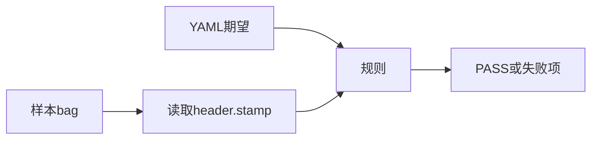

# bag-test

检查 rosbag2 里 IMU、激光扫描和 GNSS 的 header 时间戳：话题在不在、频率对不对、帧间隔有没有超限、时间有没有回退、几个话题的首帧齐不齐。样本包由脚本生成，不依赖实车数据。

Checks rosbag2 header stamps for IMU, LaserScan, and NavSatFix: presence, rate, drop gaps, backwards stamps, and start-time skew.

## 能做什么

- 按 YAML 给每个话题设置期望频率、容差和最大帧间隔
- 丢帧：相邻 header.stamp 的间隔超过阈值
- 回退：按 bag 接收顺序读，header.stamp 变小
- 缺失：期望话题没有消息
- 对齐：各话题第一条 header.stamp 的差值超过阈值
- 正常包必须通过；上面几类坏包必须失败

## 架构



## 5 分钟跑通

```bash
python3 -m venv .venv
source .venv/bin/activate
pip install -r requirements.txt
pytest
```

看一条正常包和一条丢帧包：

```bash
python -m bagcheck.sample /tmp/sensors-good
python -m bagcheck /tmp/sensors-good --expect expectations/sensors.yaml

python -m bagcheck.sample /tmp/sensors-drop --drop-scan
python -m bagcheck /tmp/sensors-drop --expect expectations/sensors.yaml
```

丢帧包会打印 `gap` 和 `FAIL`，进程退出码为 1。

## 期望格式

```yaml
sync_max_start_skew_ms: 50
topics:
  /imu/data:
    hz: 100
    hz_tolerance: 0.15
    max_gap_ms: 30
  /lidar/scan:
    hz: 10
    hz_tolerance: 0.15
    max_gap_ms: 250
  /gnss/fix:
    hz: 5
    hz_tolerance: 0.2
    max_gap_ms: 500
```

检查器用的是消息 `header.stamp`，不是本机收到包的墙钟。接收顺序仍单调、传感器时间回退时，会记为 `monotonic`。这和驱动把错误时间戳写进消息、bag 本身仍按写入顺序排列的情况一致。

## 样本里的三类坏数据

| 参数 | 注入的问题 | 期望失败项 |
| --- | --- | --- |
| `--drop-scan` | 激光在 0.5s 到 0.9s 没有帧 | `gap` |
| `--rewind-imu` | IMU 某一帧的 header.stamp 早于上一帧 | `monotonic` |
| `--no-gnss` | 不写 `/gnss/fix` | `missing` |
| `--gnss-delay 0.2` | GNSS 首帧晚 200ms | `skew` |

## 面试时怎么讲

这是数据进场景回放之前的门禁。频率和丢帧看传感器有没有断流，时间戳回退看 header 能不能拿来对齐，首帧偏差看多传感器能不能放在同一条时间线上。检查器对正常包和坏包都有测试，避免规则写错后全部 PASS。
